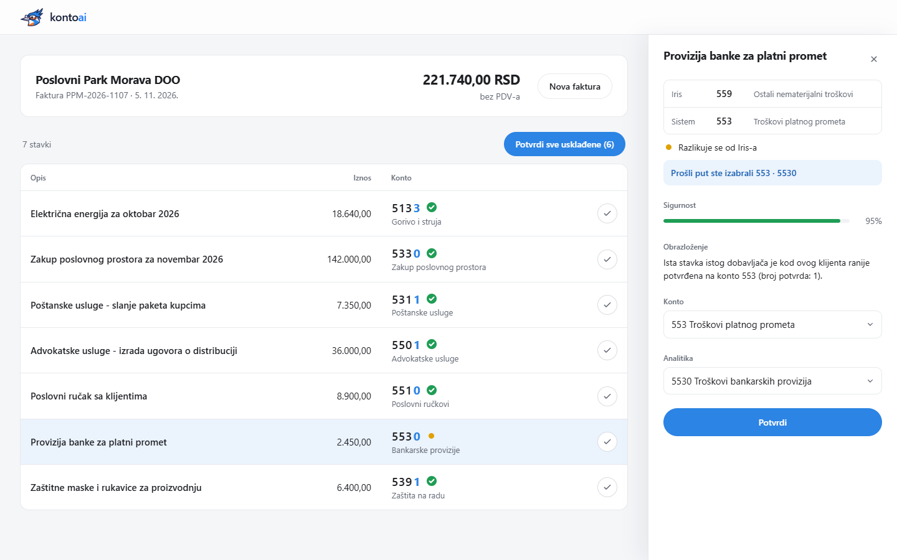
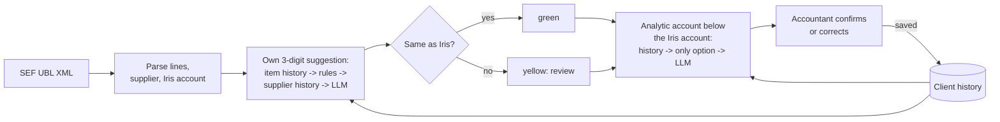

# KontoAI

[](https://github.com/cupinaa/kontoai/actions/workflows/ci.yml)

**KontoAI helps Serbian accountants post incoming e-invoices. For every invoice line it suggests the client-specific analytic account (the 4th digit), checks the 3-digit account from the accounting software, and learns from every confirmation.**



*Invoice from a supplier the accountant has posted before. Six lines match the accounting software (green check) and can be confirmed in one click. The bank fee does not: the software says 559, the system says 553. The panel offers the accountant's own earlier decision, 553 · 5530.*

> **Status: prototype.**
> - The chart of accounts and the analytic plan in this repository still need an accountant's sign-off.
> - The evaluation data is synthetic.
> - All invoices, companies, tax IDs and people in the repository are invented.

## The problem

Since SEF (*Sistem e-faktura*), incoming invoices arrive as structured UBL 2.1 XML. The accountant's software (here Iris) already proposes the **3-digit synthetic account** for each line.

The slow part is the **analytic account**: the fourth digit, e.g. 533**0** office rent vs. 533**1** warehouse rent. It is not prescribed by the *Pravilnik o kontnom okviru*. Every company defines its own analytic chart, so choosing it means remembering how *this* client books *this* supplier and *this* kind of item. Accountants do it line by line, every month.

KontoAI focuses on that step:
- It suggests the analytic account only from the client's own plan.
- It reuses the accountant's earlier decisions.
- It asks an LLM only when there is nothing to learn from.
- It cross-checks the 3-digit account against the accounting software.
- The accountant always makes the final call.

## How it works



**3-digit account.** The system always computes its own suggestion and compares it with the account from the accounting software:

| Step | Source | Notes |
|---|---|---|
| 1 | **Item history** | The same supplier and the same or a similar description were confirmed before for this client. |
| 2 | **Keyword rules** ([`data/rules.json`](data/rules.json)) | Fuel, energy, rent, telecom, office supplies, bank fees, insurance, accounting services, advertising. They are activity-aware: fuel bought by a petrol station is goods, not an expense. |
| 3 | **Supplier history** | Used only if **all** confirmed items of that supplier are on one account and there are at least two. |
| 4 | **LLM** (Gemini) | Gets masked text only, and a JSON schema restricts it to the allowed accounts. |

The result is shown as a **green check** (matches Iris) or a **yellow dot** (differs, so it needs review). The Iris account stays authoritative for the next step.

**Analytic account.** It is chosen only among the client's analytic accounts below the 3-digit account:

| Step | Source | Notes |
|---|---|---|
| 1 | **The accountant's earlier decision** | Same item and supplier, and the same Iris account as last time: her account and analytic account are preselected. The panel says *"Prošli put ste izabrali 553 · 5530"*. |
| 2 | **History** | Item, then supplier, but always below the current 3-digit account. |
| 3 | **Only one option** | No LLM call is needed. |
| 4 | **LLM** | Chooses from the offered list. An answer outside the list is rejected. |

Something is **always preselected**, so the accountant only confirms or changes it:
- An unsure suggestion is preselected but stays yellow and is not part of *Potvrdi sve usklađene*.
- When no offered analytic fits, the closest one is preselected. The panel says *"Nijedna analitika ne odgovara dobro"* and offers a better 3-digit account if the model names one.
- Without a usable LLM answer (no key, an error, or the call limit reached), the option whose name shares most words with the line is preselected and flagged.

Every confirmation is stored in the client's history (SQLite). The next invoice from the same supplier is mostly answered from history, without LLM calls.

## Privacy

- **Masking.** Before any LLM call, [`app/masking.py`](app/masking.py) replaces identifying data with placeholders:
  - the supplier name, PIB and matični broj;
  - bank accounts and IBANs, JMBG, e-mail addresses and phone numbers;
  - person names introduced by words such as *kontakt:* or *za zaposlenog*.
- **What the model sees.** Only the masked line text, the client's activity and the list of allowed accounts. Supplier identity and the client's name are never sent. The placeholder mapping stays on the server and is used only to unmask the model's explanation.
- **XML parsing** uses `defusedxml`, so XXE and entity-expansion attacks are rejected.
- **Cost and call control.**
  - Identical masked requests are answered from an in-memory cache.
  - A server-wide hard limit on LLM calls is available (`KONTOAI_MAX_LLM_CALLS`).
  - `KONTOAI_DISABLE_LLM=1` runs the app with no LLM at all.

## Results (read with care)

> [!WARNING]
> **The evaluation dataset is synthetic, and I wrote it.** The 50 items, their expected accounts and the keyword rules were all written by the same person. The numbers below show that the pipeline works as designed. They are **not** a measure of real-world accuracy.

[`scripts/evaluate.py`](scripts/evaluate.py) runs [`data/eval/dataset.json`](data/eval/dataset.json) through the 3-digit pipeline. The dataset has 30 easy items and 20 hard ones: ambiguous descriptions, invoice abbreviations, activity-dependent items and items no rule covers. One run on `gemini-3.6-flash` (2026-11-07, full report in [`eval_results.md`](eval_results.md)) gave:

| | Items | Matched the expected account | Flagged for review | Wrong and *not* flagged |
|---|---|---|---|---|
| Easy | 30 | 30 | 0 | 0 |
| Hard | 20 | 19 | 4 | 0 |

- The easy 100% is true by construction, because the rules were written with those items in mind.
- The one miss was an ambiguous line, and it was flagged for review.
- History (6) and rules (12) decided 18 of the 50 items without the LLM, all of them correctly. The other 32 went to the LLM.

**A practising accountant reviewed the material blind**, without seeing the expected account or the system's suggestion ([`data/review/`](data/review)):
- **Chart of accounts:** she confirmed 22 of the 25 accounts and was unsure about 3.
- **Blind check:** she answered 19 of the 50 items. 11 got an account and 8 a `?`, meaning the description was not enough.
- **Agreement:** on the 11 items with an account, she agreed with the system on the 3-digit level in **7**.
- **The 4 disagreements** were all lines the system was confident about, so for her they would be silent errors. They come from accounting policy, not misreading:
  - a laptop booked as an expense instead of a fixed asset;
  - yeast booked directly to expense instead of stock;
  - toner;
  - diesel bought by a petrol station.

  Some disagreements may reflect the accountant answering from her own client's accounting policy rather than the business activity listed next to each item; this is not yet confirmed.
- **Overconfidence:** of her 8 `?` items, the system had flagged only 1. It is more confident than it should be on vague lines.

This is the main lesson. A generic model encodes *one* accounting policy, while each client has its own. That is why KontoAI learns per client and treats its suggestions as proposals.

**The analytic step has no accuracy number yet.** The current analytic plan was built from the same accountant's answers, so measuring against them would grade the system against itself. It will be measured once a real analytic plan and postings that were not used to build it are available.

## Running it

Requires Python 3.12+ (developed on 3.14).

```powershell
python -m venv .venv
.\.venv\Scripts\Activate.ps1
pip install -r requirements-dev.txt
Copy-Item .env.example .env        # optional: put GEMINI_API_KEY into .env
```

**Without an LLM.** History, rules and the analytic plan still work, and nothing is sent anywhere:

```powershell
$env:KONTOAI_DISABLE_LLM = "1"; .\.venv\Scripts\python.exe -m uvicorn app.main:app --port 8000
```

**With Gemini.** This uses the key from `.env`. Every uploaded invoice can make paid API calls, so optionally cap them:

```powershell
$env:KONTOAI_MAX_LLM_CALLS = "20"; .\.venv\Scripts\python.exe -m uvicorn app.main:app --port 8000
```

Open http://127.0.0.1:8000 and drop [`data/samples/07_test_dijetetika.xml`](data/samples/07_test_dijetetika.xml) on the page. That invoice belongs to the demo client `K001`, who has the trial analytic plan. A step-by-step manual test (in Serbian) is in [`docs/RUCNI_TEST.md`](docs/RUCNI_TEST.md).

To disable the LLM, use `KONTOAI_DISABLE_LLM=1`. Do not try `$env:GEMINI_API_KEY = ""`: in PowerShell that deletes the variable, and the key from `.env` is then loaded again.

**Docker:**

```bash
docker build -t kontoai .
docker run --rm -p 8000:8000 --env-file .env -v kontoai-data:/data kontoai
```

**Tests and evaluation:**

```powershell
pytest                                   # no network and no API key needed: Gemini is mocked
python scripts/evaluate.py --dry-run     # plan an evaluation: calls needed, nothing sent
python scripts/evaluate.py --max-calls 40
```

GitHub Actions runs the tests and builds and smoke-tests the Docker image on every push.

## API

| Method | Path | Purpose |
|---|---|---|
| POST | `/invoices/xml` | Upload a SEF XML (`file`, `client_activity`, optional `client_id`) and get suggestions |
| POST | `/invoices` | The same with JSON lines; a line may carry `given_konto`, the account from the accounting software |
| POST | `/confirm` | Confirm or correct a line (3-digit and analytic account); stored in the client's history |
| GET | `/history/{client_id}` | Confirmed postings |
| GET | `/analytic-plan/{client_id}` | The client's analytic accounts |
| GET | `/accounts`, `/health` | Chart of accounts; status, LLM calls and token usage |

Interactive docs are at `/docs`.

## Data in this repository

| Path | What it is |
|---|---|
| [`data/kontni_okvir.json`](data/kontni_okvir.json) | 25 three-digit accounts from the *Pravilnik o kontnom okviru* (Sl. glasnik RS 89/2020) that are relevant to incoming invoices. A demonstration subset that is **not verified**. |
| [`data/analiticki_plan.json`](data/analiticki_plan.json) | **Trial** analytic plan for client `K001` (17 accounts), built from the accountant's review answers. It will be replaced by an export from the accounting software via [`scripts/import_analytic_plan.py`](scripts/import_analytic_plan.py), which takes CSV or XLSX with configurable columns. |
| [`data/samples/`](data/samples) | Invented SEF invoices. In invoices 06 and 07 the accounting-software account is carried in `cbc:AccountingCost` **for the demo only**. In practice Iris does not write it into the supplier's XML; the accounts would come from an Iris export and be sent as `given_konto`. |
| [`data/eval/`](data/eval) | The synthetic evaluation dataset, the accountant's own example items, and the suggestions from the evaluation run. |
| [`data/review/`](data/review) | The Excel files the accountant filled in, the decisions taken after her review, and the comparison report. [`scripts/review.py`](scripts/review.py) generates and imports them. |

## Project structure

```
app/            FastAPI app, pipeline (classifier, history, rules, masking), LLM provider, web page
  llm/          LLMProvider interface, Gemini implementation, in-memory cache
  static/       single-page UI (plain HTML/CSS/JS) and brand assets
scripts/        evaluation, accountant review, analytic-plan import, sample and brand-asset generators
data/           chart of accounts, rules, analytic plan, samples, evaluation and review data
tests/          pytest suite (Gemini always mocked)
docs/           screenshots, mascot source, manual test
```

The model can be swapped. The rest of the app only uses the `LLMProvider` interface ([`app/llm/base.py`](app/llm/base.py)), and the Gemini model is set by `GEMINI_MODEL`, by default `gemini-3.6-flash`.

## Limitations

- **Unverified reference data.** The chart of accounts is a partial, unverified list, and the analytic plan is a trial version derived from a single accountant's answers.
- **Synthetic evaluation.** There is no accuracy number for the analytic step, and the 3-digit evaluation is too small and too close to the rules to say how the system performs on real invoices.
- **One accounting policy.** Fixed-asset thresholds and expense-vs-stock decisions differ between clients. The system learns them only from confirmations, and a generic LLM tends to be overconfident about them.
- **Simple history matching.** Text similarity is word overlap, so rewordings such as *"zakup kancelarije"* vs. *"zakup poslovnog prostora"* are not recognised as the same item.
- **Pattern-based masking.** It covers the identifiers listed above but cannot recognise every personal name in free text.
- **Out of scope:** VAT, the supplier account and the full posting entry.
- **Prototype operations.** There is no authentication or multi-user access control, SQLite is the store, and lines are sent to the LLM one at a time.
- **Logo as PNG.** The mascot is a PNG, because the SVG tracer (vtracer) crashes on Python 3.14.

## Next steps

1. Import the real analytic plan from the accounting software, and get a set of real, already-booked invoices to measure the analytic step on.
2. Import the accounting software's 3-digit proposals through its export instead of the demo `AccountingCost` field.
3. Per-client accounting policy (fixed-asset threshold, expense vs. stock) as explicit settings.
4. Better item matching (embeddings), batching LLM calls per invoice, and the full posting entry including VAT.
